# TicketDeskPro-API

[](https://github.com/morshedmilton/TicketDeskPro-API/actions/workflows/ci.yml)


Enterprise Support Ticketing & SLA Platform — backend API built with **ASP.NET Core 10**, **EF Core 10**, **PostgreSQL**, **Redis** and **SignalR**.

🚀 **Live:** https://ticketdeskpro-api.onrender.com · Swagger: https://ticketdeskpro-api.onrender.com/swagger · Frontend: https://ticketdeskpro-client.vercel.app

## Architecture

Clean Architecture, five layers (see `brain/03_FRD.md`):

```
src/
├── TicketDeskPro.Api            # Controllers, Hubs, middleware, pipeline
├── TicketDeskPro.Application    # Services, DTOs, validators, mappings
├── TicketDeskPro.Domain         # Entities, enums, interfaces (no dependencies)
├── TicketDeskPro.Infrastructure # EF Core, repositories, background jobs, external services
└── TicketDeskPro.Shared         # Exceptions, constants, extensions
```

## Features & Modules

Every module ships with a simple diagram so a reader understands it at a glance.

### 🔐 Authentication (Phase 2)

Login with email + password. Rate-limited per (IP, email) via a Redis sliding window, account locks after 5 failed attempts, and the response never reveals whether an email exists.

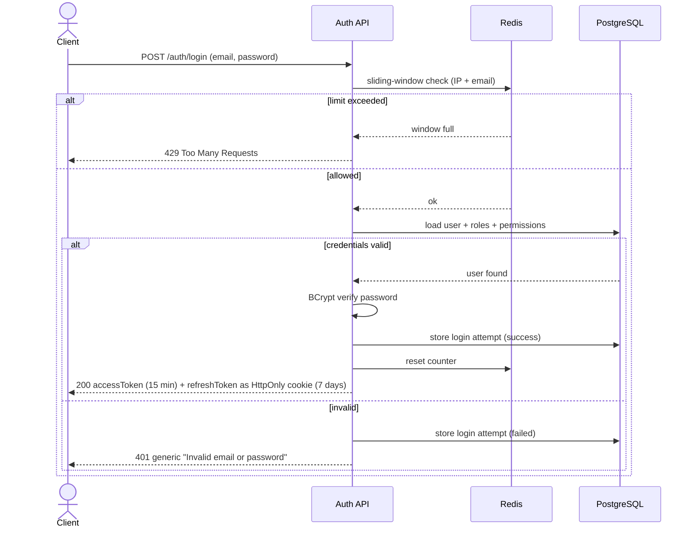

### 🔄 Refresh Token Rotation (Phase 2)

Every refresh burns the old token and issues a new one in the same session family. Presenting an already-used token means it leaked — the whole family dies and everyone must log in again.

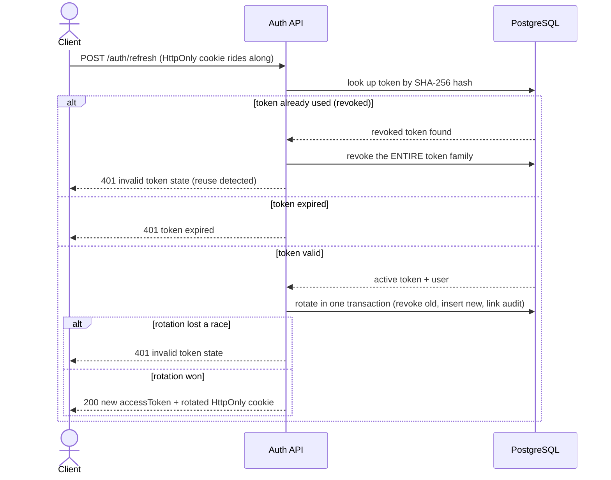

### 🔑 Password Reset (Phase 2)

Forgot-password always returns the same response (no email enumeration); the reset email goes through the transactional outbox; resetting the password kills every active session.

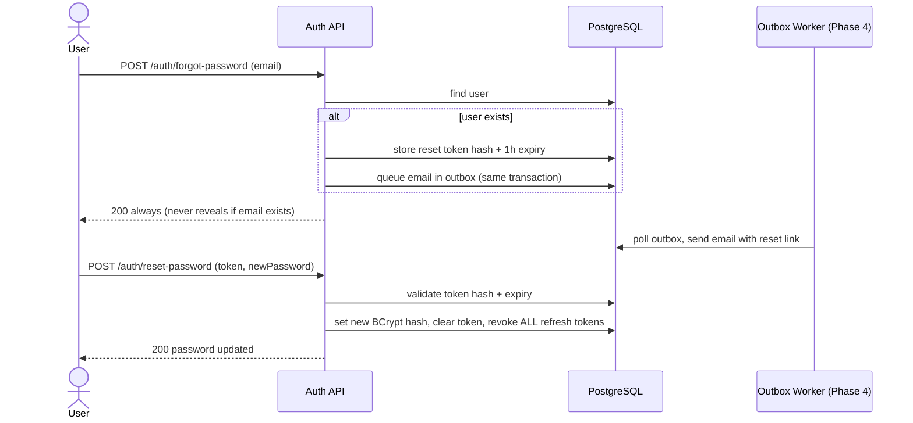

### 🛡️ Permission-Based Authorization (Phase 2)

Permissions ride the JWT; a `RequirePermission` filter gates each endpoint; the service adds ownership rules on top (customers only ever see their own tickets — as a 404, so attackers can't probe which tickets exist).

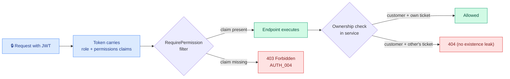

### 🎫 Ticket Lifecycle (Phase 3)

A 7-state workflow enforced by a server-side state machine — invalid jumps return `409`. An Admin may force-close from **any** state (BR-018, dashed), and a resolved ticket auto-closes after 48h once the Phase 4 job lands.

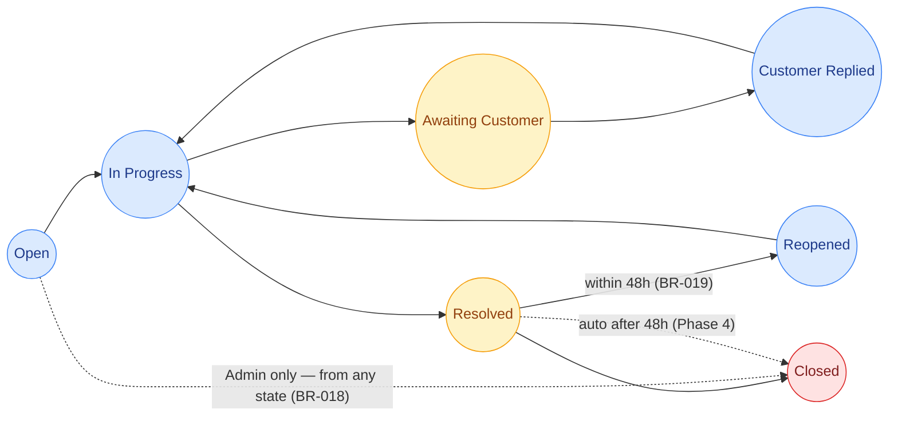

### 🆕 Creating a Ticket (Phase 3)

One transaction writes the ticket, its SLA stopwatch (deadlines from the priority policy) and the audit row. Concurrency-safe `TKT-0001` numbering; response carries an `ETag` for optimistic updates.

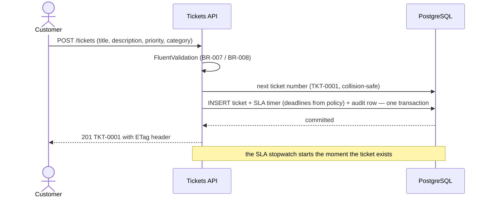

### 💬 Replies & Internal Notes (Phase 3)

Customers and agents talk in one thread. Agents can post internal notes that customers never see — and the first public agent reply stamps the SLA first-response time.

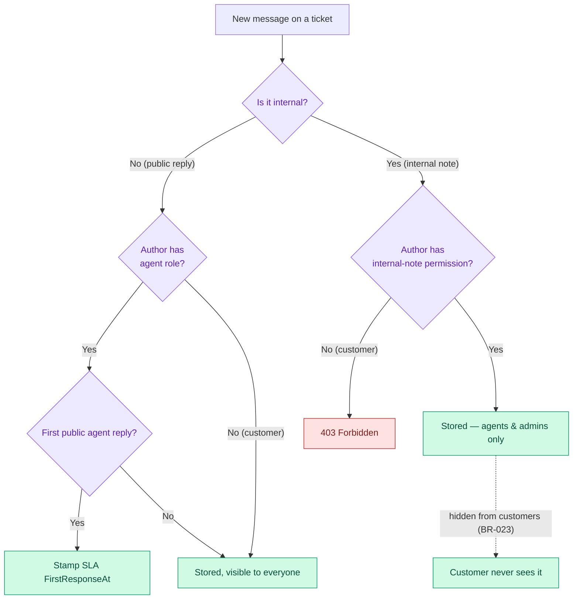

### 📎 File Attachments (Phase 3)

Uploads pass a strict gate before touching disk: safe extension list, 5MB cap, 5 files per ticket. Storage paths are sanitized against traversal attacks.

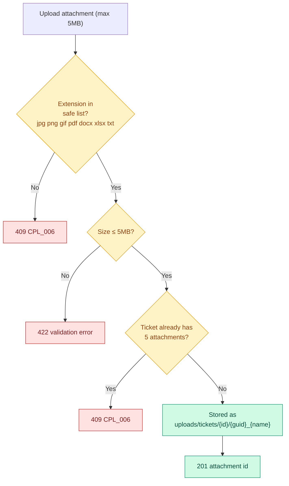

### 🗑️ Soft Delete & Restore (Phase 1 + 3)

Delete never removes rows — an interceptor flips `isDeleted` and stamps who did it; an audit row captures the action. Admins can restore a deleted ticket at any time.

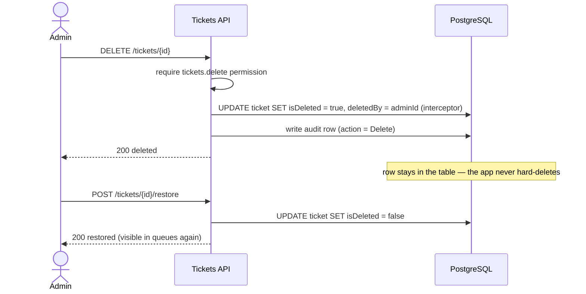

### 📮 Outbox Pattern — Guaranteed Email Delivery (Phase 4)

Emails are never written directly inside a request. The email row is committed **in the same transaction** as the business change; a background worker sends it with retries over Brevo's HTTPS API (Render free blocks outbound SMTP ports). If the email API dies, no email is lost — it waits.

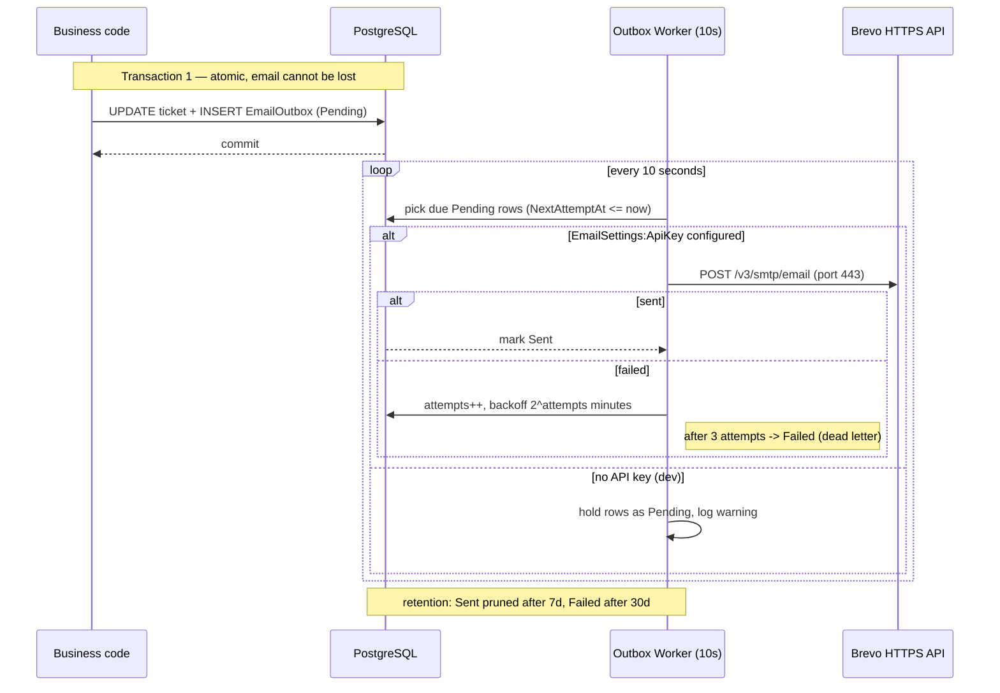

### ⏱️ SLA Checker Worker (Phase 4)

A watchdog that wakes every 60 seconds: warns at 75% elapsed, records breaches (escalating priority), and auto-closes tickets that sat Resolved for 48 hours.

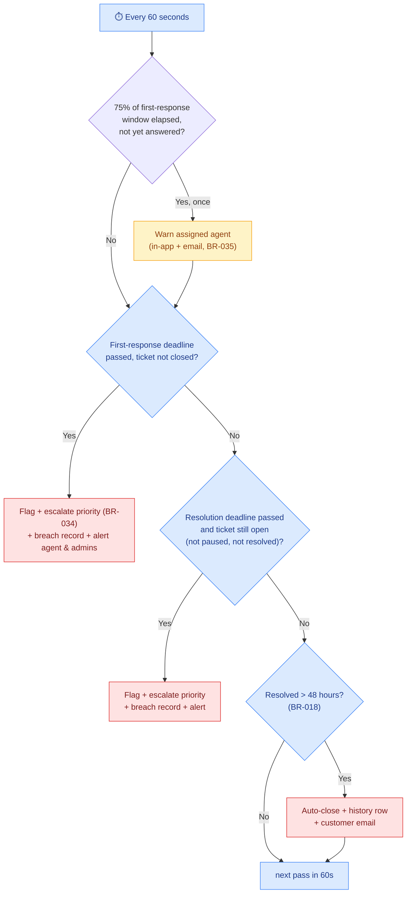

### 📡 Domain Events → Notifications & Real-time (Phase 4)

Raising an event on an entity is all a service does — after the transaction commits, handlers fan out to in-app notifications, outbox emails and SignalR pushes. A failing handler is logged, never breaks the request.

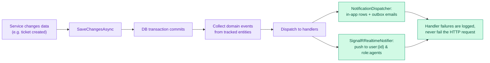

Also in this phase: **manual ticket assignment** (`POST /tickets/{id}/assign`, claim-to-InProgress), **round-robin auto-assignment** to the least-loaded active agent on creation, and **SignalR hub** at `/hubs/notifications` (JWT via header or `?access_token=`).

### 📊 Dashboard & Redis Cache-Aside (Phase 5)

Dashboard numbers are expensive to compute, so they live in Redis for 30 seconds — and every ticket mutation deletes the cache so the next read is always fresh. Redis failing never breaks a request: reads fall through to the database, invalidations are skipped.

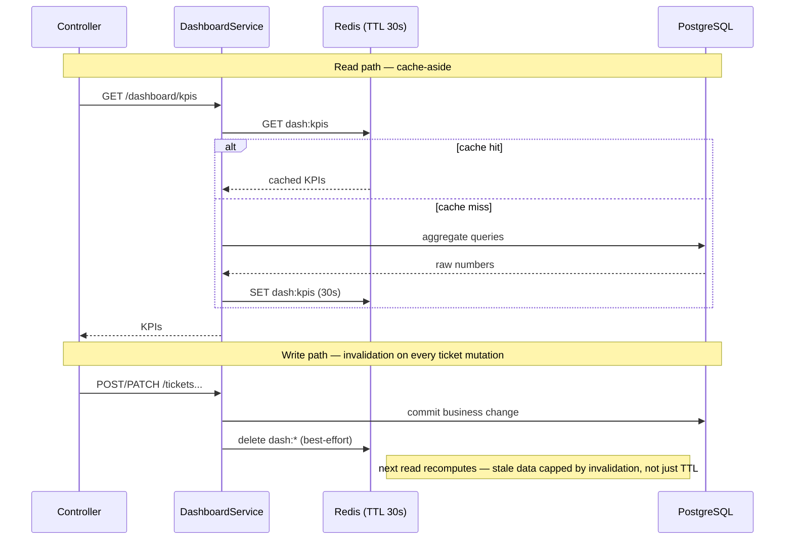

### 🏥 Liveness vs Readiness (Phase 5)

Two probes, two questions: `/healthz` = "is the process alive?" (touches nothing). `/readyz` = "can it serve?" (pings PostgreSQL + Redis, answers 503 degraded when either is down). The full paths are **`/api/v1/health/healthz`** and **`/api/v1/health/readyz`** — Render's deploy health check and UptimeRobot probe the first one, so treat it as a stable contract (a wrong path 404s and turns every deploy into a 15-minute timeout). Plus structured logging: Serilog writes console + daily rolling files with the `CorrelationId` on every line.

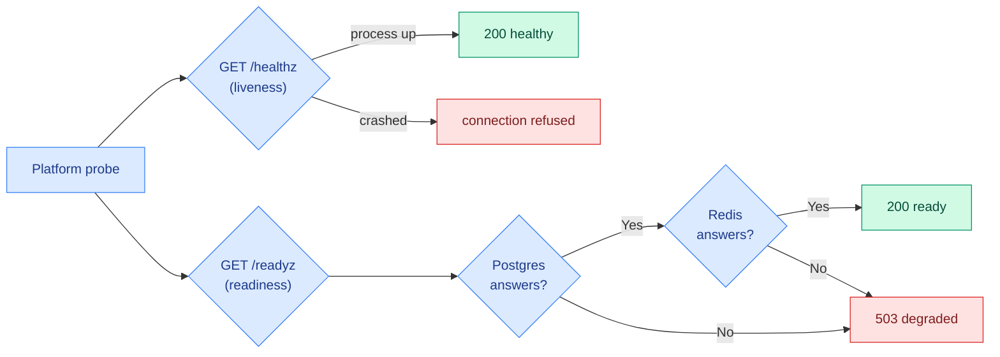

Also in this phase: **admin panel endpoints** — user management (with BR-38 SuperAdmin guards and escalation protection), SuperAdmin role/permission builder (system roles locked), category & tag CRUD, filterable audit-log viewer, and per-user notification preferences.

## Database Schema

20 tables, code-first via EF Core. Colors group the modules:
**blue** = Identity & Access · **violet** = Ticketing · **amber** = SLA · **emerald** = Audit & Notifications · **slate** = join tables.

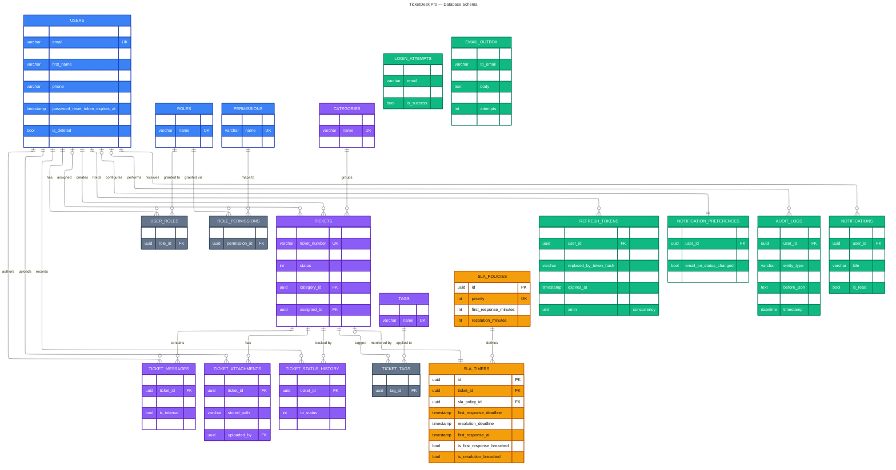

<br>

<sub>Notes: every table also carries `id`, `created_at`, `updated_at` and soft-delete columns (`is_deleted`, `deleted_at`, `deleted_by`) from `BaseEntity` — except the three join tables (composite keys) and `audit_logs` (append-only by design). `EMAIL_OUTBOX` and `LOGIN_ATTEMPTS` intentionally have **no foreign keys** — they address users by email string, which is why they float free above.</sub>

## Roadmap

| Phase | Module | Status |
|---|---|---|
| 1 | Database design, EF Core migrations, seed data | ✅ Shipped |
| 2 | JWT auth, refresh-token rotation, RBAC | ✅ Shipped |
| 3 | Ticket CRUD, state machine, messages, attachments, audit | ✅ Shipped |
| 4 | SLA engine + notifications (Outbox, SignalR) | ✅ Shipped |
| 5 | Dashboards & analytics (Redis KPIs, admin panel, health checks) | ✅ Shipped — backend complete |
| 6 | Frontend auth & layout (`TicketDeskPro-Client`) | ✅ Shipped |
| 7 | Frontend tickets & dashboard UI | ✅ Shipped |
| 8 | Production deployment (Render + Vercel, CI/CD) | ✅ Shipped |

## Prerequisites

- .NET SDK 10.0.x
- Docker (for PostgreSQL + Redis)

## Getting started

```bash
# 1. Start PostgreSQL + Redis
docker compose up -d

# 2. Run the API (migrates + seeds automatically on startup)
dotnet run --project src/TicketDeskPro.Api
```

Health check: `GET /health`

## Deployment (Phase 8)

$0 production: **Render** (Docker web service) → **Neon** Postgres → **Upstash** Redis · **Vercel** for the client · deploy hook fired by GitHub Actions after tests pass · UptimeRobot pings `/api/v1/health/healthz` every 5 min so the free instance never spins down.

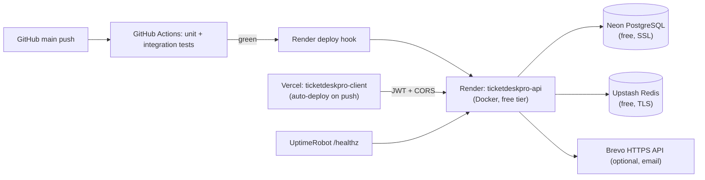

Full step-by-step: `brain/06_DEPLOYMENT_GUIDE.md` (private).

## Seeded demo data

All demo users share the password `Admin123!`. Local dev always seeds them; production only when `SeedDemoUsers=true` (the live portfolio demo):

| Email | Role |
|---|---|
| superadmin@ticketdesk.dev | SuperAdmin |
| admin@ticketdesk.dev | Admin |
| agent@ticketdesk.dev | Agent |
| customer@ticketdesk.dev | Customer |

Also seeded: 4 system roles, 24 permissions, 4 SLA policies, 4 ticket categories.

## Useful commands

```bash
dotnet build
dotnet ef migrations add <Name> --project src/TicketDeskPro.Infrastructure --startup-project src/TicketDeskPro.Api
```

## Project docs

The `brain/` folder holds the full requirement set: BRD, PRD, FRD, API Specification, Database Design.
