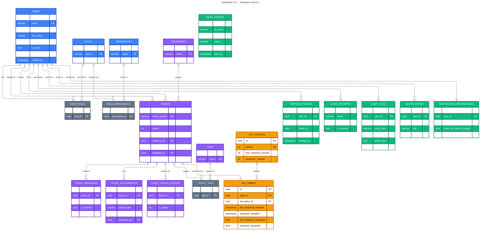

# TicketDeskPro-API

Enterprise Support Ticketing & SLA Platform — backend API built with **ASP.NET Core 10**, **EF Core 10**, **PostgreSQL**, **Redis** and **SignalR**.

## Architecture

Clean Architecture, five layers (see `brain/03_FRD.md`):

```
src/
├── TicketDeskPro.Api            # Controllers, Hubs, middleware, pipeline
├── TicketDeskPro.Application    # Services, DTOs, validators, mappings
├── TicketDeskPro.Domain         # Entities, enums, interfaces (no dependencies)
├── TicketDeskPro.Infrastructure # EF Core, repositories, background jobs, external services
└── TicketDeskPro.Shared         # Exceptions, constants, extensions
```

## Database Schema

20 tables, code-first via EF Core. Colors group the modules:
**blue** = Identity & Access · **violet** = Ticketing · **amber** = SLA · **emerald** = Audit & Notifications · **slate** = join tables.



<br>

<sub>Every table also carries `id`, `created_at`, `updated_at` and soft-delete columns (`is_deleted`, `deleted_at`) from `BaseEntity` — omitted above for readability.</sub>

## Prerequisites

- .NET SDK 10.0.x
- Docker (for PostgreSQL + Redis)

## Getting started

```bash
# 1. Start PostgreSQL + Redis
docker compose up -d

# 2. Run the API (migrates + seeds automatically on startup)
dotnet run --project src/TicketDeskPro.Api
```

Health check: `GET /health`

## Seeded demo data

All demo users share the password `Admin123!` (local development only):

| Email | Role |
|---|---|
| superadmin@ticketdesk.dev | SuperAdmin |
| admin@ticketdesk.dev | Admin |
| agent@ticketdesk.dev | Agent |
| customer@ticketdesk.dev | Customer |

Also seeded: 4 system roles, 24 permissions, 4 SLA policies, 4 ticket categories.

## Useful commands

```bash
dotnet build
dotnet ef migrations add <Name> --project src/TicketDeskPro.Infrastructure --startup-project src/TicketDeskPro.Api
```

## Project docs

The `brain/` folder holds the full requirement set: BRD, PRD, FRD, API Specification, Database Design.
